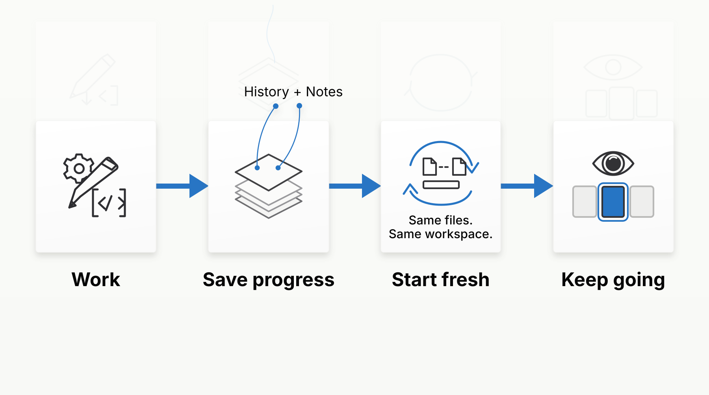

<div align="center">

# Claude Context Continuity


**Codex-style context continuity for native Claude Code.**

Keep long-running work moving with a context budget, a fresh start at the right moment, access to the original conversation, and short working notes.

[简体中文](README.zh-CN.md) · [Repository](https://github.com/macchen123/claude-context-continuity) · [License](LICENSE)

[](pyproject.toml)
[](LICENSE)
[](#platform)
[](https://linux.do)

<sub>Concept illustration — not a terminal screenshot.</sub>

</div>

[Why](#why) · [How it works](#how-it-works) · [Start in three steps](#quick-start) · [Everyday use](#everyday-use) · [Cron Workaround](#cron-compat) · [Advanced Features](#advanced) · [Privacy](#privacy) · [FAQ](#faq) · [Contributing](#contributing) · [Acknowledgments](#acknowledgments)

<a id="why"></a>
## Why Claude Context Continuity?

Claude Code natively provides `/compact` to summarize growing conversations. However, in complex or long-running tasks, repeatedly relying on summaries can introduce serious pain points:

- **Crucial details get dropped:** Strict constraints, architecture decisions, or edge cases established early on rarely survive multiple rounds of summary compression.
- **Drift and compounding errors:** Once key context is lost, the model tends to hallucinate or deviate, resulting in code that diverges from your initial specifications.
- **Workflow interruptions:** Waiting for compaction takes time, and rebuilding background context manually takes even more.

**Our approach: Inspired by Codex.**  
Instead of summarizing in-place, we monitor your token budget. When you approach the limit, we switch cleanly to a fresh context window while passing forward a concise handoff. The entire original history remains fully searchable locally. **Replace lossy compression with seamless context continuity.**

You keep your existing native Claude Code setup. This tool does not rebuild coding models or replace your tools. It is an independent community project inspired by Codex's [new-context mechanism](https://github.com/openai/codex/blob/rust-v0.153.4/codex-rs/core/src/tools/handlers/new_context_window_spec.rs) and [History/Notes tools](https://github.com/openai/codex/blob/rust-v0.153.4/codex-rs/ext/history-notes/src/tools.rs).

---

<a id="how-it-works"></a>
## How it works



<p align="center"><em>Concept flow — not a terminal screenshot.</em></p>

1. **Prepare before the limit:** Leaves room for a handoff before the conversation fills up, rather than stopping when space has already run out.
2. **Keep work moving:** Background tasks keep running. Messages sent during the switch and drafts you haven't submitted are kept, so you don't have to start over.
3. **Find details when you need them:** A short handoff goes to the new window; the original conversation stays available locally. Look up the details you need instead of relying only on a summary.

| With `/compact` | With Context Continuity |
| --- | --- |
| Compresses conversation in-place via summary | Switches cleanly to a fresh context window |
| Lossy: early constraints and details easily get lost | Carries key progress forward; exact history remains queryable |
| Prone to compounding errors over long runs | Stays in an optimal low-latency, high-accuracy context range |

---

<a id="quick-start"></a>
## Start in three steps

### 1. Requirements & Installation

Prerequisites: Python 3.10+, Git, `tmux`, and native Claude Code **2.1.304 or newer**. Run `claude --version` to check your installed version. This version follows the current native contract; it does not migrate obsolete runtime states. If an old state is rejected, start a new `cclaude` session. Existing histories and notes remain on disk.

```sh
python3 -m pip install "git+https://github.com/macchen123/claude-context-continuity.git"
```

*Note: Installation does not modify your global Claude Code settings. All hooks and custom commands are loaded dynamically per session via a local plugin.*

### 2. Set Context Budget

Set your desired token ceiling based on your model's effective context capacity (e.g. 200k):

```sh
export CLAUDE_CODE_MAX_CONTEXT_TOKENS=200000
```

### 3. Launch

Run `cclaude` in place of your usual `claude` command:

```sh
cclaude
```

*(Optional: If you wish to disable native auto-compaction for this session, pass `DISABLE_COMPACT=1 cclaude`)*

---

<a id="everyday-use"></a>
## Everyday use

Work in your project directory exactly as you normally do with Claude Code.

When the conversation gets close to full, the tool opens a fresh context window and continues the current work. Background tasks keep running, messages sent during the switch are handled in the new window, and unfinished drafts are not sent.

Monitoring stays active across successive windows. If native history or a switch confirmation is still arriving, the tool waits and continues automatically when it can verify the next step. It may hold the next model request to protect the remaining context; that is not a task completion or a shutdown of monitoring.

### Proactive rotation with `/renew`

If you've completed a milestone and want to start fresh immediately, type inside your session:

```text
/renew
```

The model drafts a quick handoff note and safely rotates to a new window. If another plugin occupies `/renew`, use `/cclaude:renew`.

---

<a id="cron-compat"></a>
## Scheduled Tasks (CronCreate) Bug Workaround

In official Claude Code releases, there is a known upstream issue: **Running `/clear` in a session can break session binding for newly created durable tasks (`CronCreate(durable=true)`), causing them to stay on disk without firing.**

Since rotating context involves session boundaries, this package includes a lightweight, reversible workaround enabled by default:
- It automatically aligns new durable tasks with the active scheduler session so they fire reliably.
- **Never modifies official binaries.** Tasks remain in the official `.claude/scheduled_tasks.json`, and native commands like `CronList` / `CronDelete` continue to work normally.

**Controls:**
- **Disable workaround** (e.g., after upstream officially fixes the issue):
  ```sh
  CCLAUDE_DURABLE_CRON_COMPAT=off cclaude
  ```
- **Inspect status:**
  ```sh
  claude-context cron-compat status --context-id "$CLAUDE_CONTINUITY_ID"
  ```
- **Revert modifications:**
  ```sh
  claude-context cron-compat restore --context-id "<context-id>"
  ```

---

<a id="agent-compat"></a>
## Subagent Identity Across Context Windows

Native Claude Code needs both a subagent's identity (`.meta.json`) and native history (`agent-<id>.jsonl`) in the current session to resume a completed child. Metadata alone can report a preserved role while native `SendMessage` still fails with `No transcript found for agent ID`.

cclaude establishes both native loader inputs from its catalogued sessions at `SessionStart` and revalidates them before `SendMessage`, the current native resume entry:

- Resuming a session retains its validated earlier history references, including when that session contains new user instructions. Those instructions remain authoritative; inheriting the catalogue does not adopt an older owner's authorization.
- Native role, explicit model, permission/isolation fields, and opaque extension fields are preserved. Agent definitions, global settings, and official binaries are untouched.
- A single native child-history stream is shared across parent sessions through hard links, so native appends remain visible across repeated rotations. If registered sessions instead contain consecutive fragments, native `parentUuid` ancestry orders the fragments into a complete loader stream, including the original prompt and tool results—not just the latest suffix. Each input is retained byte-for-byte under `agent_history/` before publishing the complete stream; earlier source files are not rewritten. An existing current-session suffix can be replaced only when it is one of those verified inputs. Later rotations share the complete stream through hard links. This does not restart a child or change its current native `finished` lifecycle flag. A child's own budget can stop it through the handoff below.
- Identity conflicts, competing continuation branches, missing predecessors, and unrelated destination histories block restoration instead of reporting metadata-only success. A new cross-window connection requires complete, readable, bounded input histories. Existing native/current or already established streams retain native append semantics: a partial last line or large record does not by itself block messaging; identity and child-budget guards still apply. Separate files with identical bytes alone do not establish ancestry. Hard-link publication must be supported on the same filesystem. Messages to `main` and identifiable non-local peers are unaffected.
- A narrowly recognized native default-fallback record can be restored from a verified original sidecar only after the agent stops. Identity repair evidence is kept in the context's private `agent_metadata/` directory; native-history publication evidence is in `agent_history/`. Other identity conflicts are not overwritten.
- Native `stoppedByUser` markers remain effective. Native fork, model, tool, and current-permission checks still apply; preservation does not grant new authority.

Inspect `agent_metadata_compat` with `claude-context tui-status --context-id "$CLAUDE_CONTINUITY_ID"`. Investigate a blocked restore rather than changing the role or repeatedly resending to bypass it.

When collaborating with another session, its native Session ID changes after renewal. After `ListAgents`, cclaude gives the model verified cross-window associations to help recognize the continuing session. You can also find its current live entry using an old ID, including one from several renewals ago:

```sh
claude-context peer-lineage --session-id "<old-session-UUID>"
```

Omit the option for a brief overview; an exact lookup searches all confirmed windows. Associations use the live native session's Session ID, process ID and registered history; uncertain or conflicting bindings are not guessed. A successful `SendMessage` to a uniquely identified named peer can receive the same context; socket addresses are not inferred. Native routing still delivers messages, and the user's instructions still determine whether work should continue.

If an earlier version dropped the resumed session's catalogue references, run this after upgrading, using the exact `session_id` from `tui-status`:

```sh
claude-context tui-recover --context-id "$CLAUDE_CONTINUITY_ID" --session-id "<session-id>"
```

This rechecks the bound source, restores validated catalogue references and refreshes the native subagent loader inputs. It does not replay work or overwrite conflicting histories; repeating it does not add duplicate catalogue entries.

Each child reads input, cache and output usage from its own native transcript, never from its parent. Without an observed child window, the configured ceiling is an estimate with a 25% reserve. Missing usage and windows remain unknown; file bytes are not token counts.

At the reserve boundary, native `PostToolBatch` stops the next request after direct tools settle and records a handoff in the runtime context's `agent-budgets/<agent_id>.json`. The parent verifies native terminal state, original delegation, latest cancellations/restrictions and existing artifacts before starting a fresh agent with the same role, model slot, permissions and leaf boundary for unfinished, still-authorized work only. Completed work is delivered; background side effects are not restarted. This is not an in-place child `/clear` and does not use compact. `SendMessage` rejects histories already at the budget or containing a native context-length failure, including agents created before the upgrade.

The runtime context's `events.jsonl` records parent/child identities, usage/window sources, budget decisions and error origin. It retains the current file plus three backups, each at most 64 KiB, without prompts, tool bodies or credentials. `request_sent: null` means there is no send evidence; it does not establish whether CPA or an upstream service received the request. Diagnostic write failures never block tools.

---

<a id="advanced"></a>
## Advanced Features: History Search & Working Notes

When working in a fresh window, you can search across all previous session transcripts at any time:

```sh
# Search across all past context windows (powered by local SQLite FTS5)
claude-context history-search --query "database schema" --recent-first

# Inspect exact matched message content
claude-context history --source "<path>" --session-id "<id>" --message-id "<id>" --expected-sha256 "<hash>"

# Manage shared working notes
claude-context notes list
claude-context notes read plan
printf '%s' 'Milestone notes' | claude-context notes write plan
```

---

<a id="privacy"></a>
## Local Data & Privacy

All session records, notes, and search indices are stored strictly on your local machine:

```text
${CLAUDE_CONFIG_DIR:-$HOME/.claude}/session-continuity/
```

- **Local only:** No data is ever transmitted to third-party telemetry or cloud services.
- **Secret redaction:** Common secret environment variables (API keys, tokens) are stripped before writing to local index caches.
- **Model queries:** When you retrieve past history into the active conversation, it interacts directly with your configured Claude provider, exactly like normal Claude Code usage.

---

<a id="platform"></a>
## Platform Support

| Platform | Status |
| --- | --- |
| Python | 3.10+ (tested on 3.12) |
| macOS & Linux | Fully supported (requires `tmux`) |
| WSL | Functional (standard POSIX baseline) |
| Windows Native | Unsupported |

---

<a id="faq"></a>
## FAQ

### 1. Does this replace or disable native `/compact`?
No. Native `/compact` remains completely untouched. You can still invoke `/compact` manually whenever you choose.

### 2. Will the tool interrupt active commands or tasks?
It won't stop or rerun background tasks just to switch context. It waits for the current tool calls to finish, then switches; background tasks don't all have to be done. Messages sent during the switch are handled in the new window, and drafts are kept.

### 3. Can I still access details from earlier windows?
Yes. All prior sessions in the task chain are indexed locally in SQLite FTS5. Use `claude-context history-search` to query any previous turn or decision.

### 4. Does this alter Claude Code's models, prompts, or permissions?
No. You are still using native Claude Code. Your models, system prompts, MCP servers, and permission policies remain identical.

### 5. Why is automatic switching waiting?
The host may be waiting for a complete native history record, a tool result, or confirmation that a clear or handoff was received. It keeps checking and continues when the missing fact becomes available. A delayed confirmation does not permanently disable automatic switching, and an uncertain command is not sent again blindly.

Native `Stop` confirms that Claude Code has finished responding, while its history is written asynchronously. The host retains that receipt even if the transcript file or current input has not appeared yet. It verifies the exact native turn and final response once those records arrive, then continues the requested context switch automatically. Delayed records are matched by native conversation identity rather than transcript append order.

Automatic switching uses the latest native input, cache, and output token counts. When the ceiling is only a configured estimate, it reserves 25% of that window for input added after the last sample, such as skill expansions and tool batches; a 600,000-token estimate therefore yields at 450,000 tokens. This does not verify the provider's actual capacity. File sizes and tool-result bytes are not treated as tokens. Task registration, written handoff notes, and fully answered questionnaires are not prerequisites. History preserves the answers actually supplied and marks unanswered questions. Rejected or cancelled questions are not treated as consent and do not make the whole history unreadable. A first prompt arriving just before its transcript file is created is no longer misreported as a session-identity error.

A native `StopFailure` reporting `Prompt is too long` can also trigger the same safe rotation, even below the estimated threshold. The controller first verifies the exact main-session error record and settles foreground tools; background agents are not stopped or restarted. Missing or late error records remain a wait, unrelated failures never trigger a clear, and unknown control deliveries are never resent. A rejected first request without any successful native usage is reported as `context_rejection_without_native_usage` rather than resetting in a loop.

History/Notes remains available. With enough verified room, work can continue; near the context limit, the next model request is held while completed results and submitted inputs remain in native history. Use `claude-context tui-status --context-id <context-id>` to see the current stage and waiting reason. An accepted request is not proof that a new window has opened.

`PostToolBatch hook stopped continuation` together with the context-switch notice means the old turn is yielding to a new window, not that the task is finished. Peer messages and background-task notices remain readable in History; neither they nor the handoff provide new human authorization.

### 6. How do I continue after a terminal interruption?
Use the normal native resume flow: start with `cclaude --resume <session-id>`, or use `/resume` inside a managed `cclaude` session. Monitoring rebinds to the selected native session and its actual usage. If the terminal is still alive but its monitoring process exited, a genuine native hook restarts that observer without a separate repair command.

`tui-attach` only reconnects an existing terminal. `tui-status` checks the actual controller, exclusive lock, tmux session, and control socket; attaching alone is not proof that monitoring is healthy. Unreadable history or unconfirmed delivery is reported explicitly, never repaired by replaying completed work or taking over another session.

If a clear was confirmed but the handoff was never dispatched, recovery does not clear again. It continues that one pending handoff only while the new window has not started a conversation; otherwise it restores observation without inserting the old handoff. Deferred inputs remain preserved, and uncertain deliveries are never resent.

Interactive `cclaude --resume <session-id>` (or `-r`) first checks whether that managed session is still running. When exactly one live instance can be verified, it reconnects to that instance without starting another native process or controller, or upgrading an already-running process. A resume command that also supplies a new prompt, model, permission mode, or other launch options is rejected rather than silently ignoring options or delivering input twice.

Multiple live instances, unverifiable identity, or an uncertain prior launch are not resolved by automatically choosing, stopping, or restarting an instance. When this directory has a live instance, `--continue`, `--resume` without an ID, and session names are not guessed; use the complete session ID or `tui-attach`. Explicit `--fork-session` retains native independent-session behavior.

---

<a id="contributing"></a>
## Contributing

Contributions and feedback are welcome via GitHub Issues and Pull Requests.

To run tests locally:
```sh
python3 -m pip install -e .
CLAUDE_CONFIG_DIR="$PWD/.test-claude-config" \
PYTHONPATH=src \
python3 -m unittest discover -s tests -v
```

---

<a id="acknowledgments"></a>
## Acknowledgments

Thanks to the [LINUX DO](https://linux.do) community for its support and recognition.

## License

Claude Context Continuity is released under the [MIT License](LICENSE).
